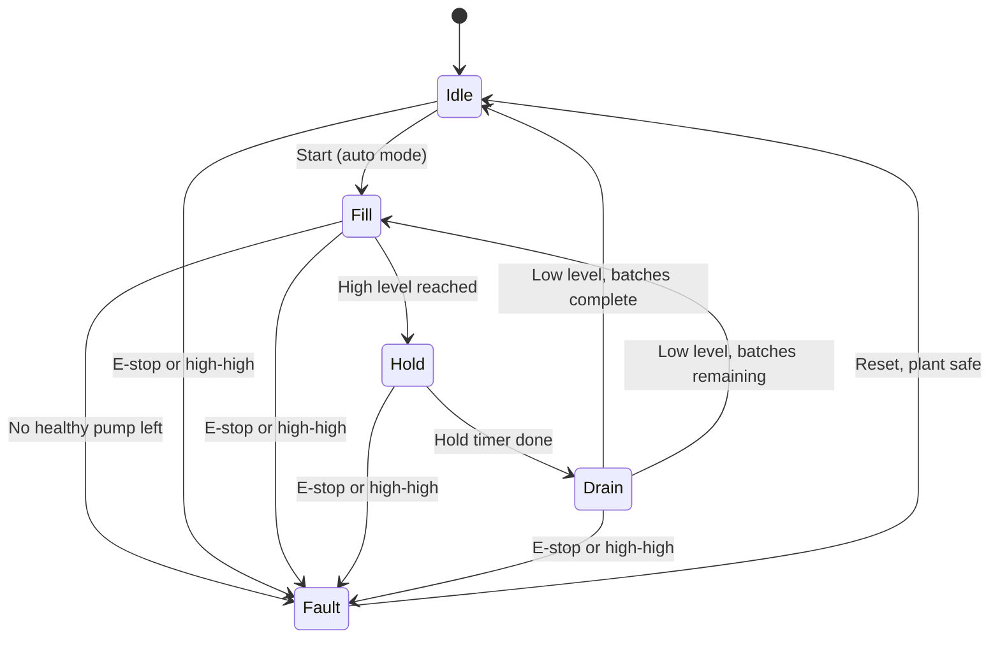

# 🏭 PLC Batching Station

## 📘 A Three-Pump Tank Batching Controller, Specified, Modeled, and Tested

I built this to practice the part of PLC work that goes beyond turning an output on: writing control logic that keeps working when something goes wrong. A three-pump station fills a tank, holds the batch, drains it, and repeats. The easy version runs one pump. The interesting version rotates the lead pump so wear is shared, detects a pump that doesn't report running, and switches to a standby pump without stopping the process.

The design comes from the topics in my EET-2410 Mechatronics course: relay logic, timers and counters, comparison and integer math, state diagrams, and indirect addressing. It is a lab and simulation project, not a production control system.

I wrote the behavior down first as a state machine, then as a reference model I could test in software, and then as a rung-by-rung build sheet for Rockwell. The Rockwell and Siemens runs are the next step, so this repo is clear about which parts are verified and which are not.

---

## 🚦 Project Status

| Item | Status |
|---|---|
| Process spec, state diagram, I/O table | Done |
| Reference model with 6 simulated scenarios | **6/6 pass** (`model/run_tests.py`) |
| Structured Text version (OpenPLC) | Written, not yet compiled |
| Rockwell ladder (RSLogix) | Build sheet written, not yet entered |
| Siemens port (TIA Portal, S7-PLCSIM) | Not started |

The software model is the specification. It is not a substitute for a PLC run, so RSLogix and Siemens results are recorded separately in `docs/test-log.md` as I get them.

---

## 🧠 Skills I Developed

### **Control Logic Design**
- Writing a five-state sequence (Idle, Fill, Hold, Drain, Fault) before touching any ladder
- Latched alarms with a reset that is refused while the unsafe condition is still present
- Normally-closed stop and E-stop contacts, so a broken wire fails safe

### **Fault Handling & Redundancy**
- Run-feedback fail detection with a timeout, so a pump that is commanded but not running is caught
- Lead/lag rotation each batch, with automatic switchover to a standby pump
- Dropping to a safe fault state when no healthy pump is left

### **PLC Programming Concepts**
- Timers, counters, comparison instructions, and integer math
- Indirect addressing: reading each batch's hold time from a recipe table by batch index
- Manual and auto modes with the sequence held while in manual

### **Testing**
- A small tank-and-pump simulation to run six scenarios: normal batch, pump failure, E-stop, high-high level, manual mode, and all pumps failed
- Breaking the logic on purpose (removing rotation and fail detection) to confirm the tests catch it

### **Cross-Platform Thinking**
- A concept map from Rockwell addressing to Siemens tags and IEC timers, and a Structured Text version that runs in the free OpenPLC Editor

---

## ⚡ What I Built

- A reference model of the controller, written as one function per PLC scan
- A simulation harness and six test scenarios
- A rung-by-rung Rockwell build sheet with a full address map
- An IEC 61131-3 Structured Text program for OpenPLC
- Siemens porting notes, an I/O table, and a test log with separate columns per platform

### State diagram



---

## 🛠️ Tech Stack

| Layer | Technology |
|---|---|
| Rockwell | RSLogix, ladder logic (build sheet) |
| Siemens | TIA Portal, S7-PLCSIM (port planned) |
| Open alternative | OpenPLC Editor, Structured Text |
| Modeling & tests | Python 3 |

---

## 🚀 Run It

```bash
git clone https://github.com/lucckkyyy/plc-batching-station.git
cd plc-batching-station

# Run the six software test scenarios
python3 model/run_tests.py
```

To run it on a PLC, enter the rungs from `rockwell/ladder-spec.md` in RSLogix, or import `st/pump_controller.st` into OpenPLC Editor. Then run the five scenarios in `docs/test-log.md` and record the results.

```
plc-batching-station/
  docs/       io-table, test-log
  model/      pump_controller.py, run_tests.py
  st/         pump_controller.st
  rockwell/   ladder-spec.md
  siemens/    porting-notes.md
```

---

## 🚀 The Learning Outcome

The main lesson was that the happy path is the smallest part of a controller. The sequence itself is a few rungs. Everything else, such as what happens when a pump doesn't start, when the E-stop opens mid-fill, or when a reset is pressed while the tank is still too full, is what makes the logic trustworthy. Writing the behavior as a testable model first, and breaking it on purpose to see the tests fail, made those cases concrete before I ever opened RSLogix.

---

*Author: Aryan Rajguru*
