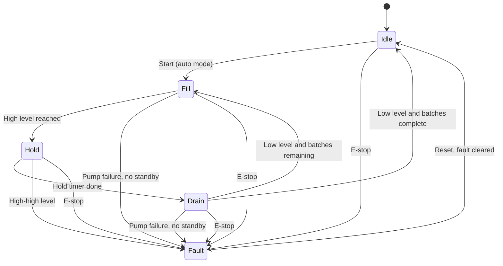

# PLC Batching Station


A PLC program that automatically runs a three-pump tank batching station: fill, hold, drain, repeat. It rotates the lead pump to balance wear, switches to a standby pump when one fails, and shuts everything down safely on an emergency stop.

It is built from the topics in my EET-2410 Mechatronics course (relay logic, timers and counters, comparison and integer math, state diagrams, indirect addressing) and programmed in Rockwell ladder logic, then ported to Siemens.

This is a lab/simulation project, not a production control system.

## Why this project exists

Factories, water plants, and hospital building systems use PLCs to run equipment automatically and safely. Someone has to write logic like "start the pump when the tank is low," "stop at high level," "swap to a backup pump on failure," and "stop everything on E-stop." This project covers those cases in one program.

## Process description

- A tank with three level sensors: low, mid, high
- Three pumps, one lead at a time, the others standby
- Start, stop, and E-stop controls plus a manual/auto selector
- A batch recipe (batch size and hold time) stored in a data table

## State diagram



## Features

- Start/stop/E-stop latch logic
- Level-based fill and drain control
- Timers for hold phase and pump feedback timeout
- Counter for batch count
- Lead/lag pump rotation (floating master)
- Pump fail detection with automatic standby switchover
- Latched alarms with reset (high-high level, pump failure)
- Manual/auto mode
- Recipe table using indirect addressing
- Port to Siemens (TIA Portal, S7-PLCSIM) for the core functions

## Project status

- [x] Process specification and state diagram
- [x] I/O table and address map (`docs/io-table.md`, `rockwell/ladder-spec.md`)
- [x] Reference model of the control logic with 6 software test scenarios, 6/6 passing (`model/`)
- [x] Structured Text version for OpenPLC (`st/`), written but not yet compiled
- [x] Rockwell rung-by-rung build sheet (`rockwell/ladder-spec.md`), not yet entered in RSLogix
- [ ] Rockwell ladder logic entered and tested in RSLogix
- [ ] Siemens port (E-stop, fill/drain, rotation) tested in S7-PLCSIM
- [ ] Screenshots and final test log

## What is verified and what is not

| Item | Evidence |
|---|---|
| Control logic behaves as specified | `python3 model/run_tests.py` runs 6 scenarios against a simulated tank and pumps. Breaking the logic on purpose makes tests fail, so they do detect errors. |
| Works in RSLogix | Not yet. Enter `rockwell/ladder-spec.md` and rerun the scenarios. |
| Works on Siemens | Not yet. |

The software model is the specification, not a substitute for a PLC run.

## I/O table

Filled in during the build.

| Address | Tag | Type | Description |
|---|---|---|---|
| TBD | START_PB | Input | Start pushbutton |
| TBD | STOP_PB | Input | Stop pushbutton |
| TBD | ESTOP | Input | Emergency stop (normally closed) |
| TBD | LVL_LOW / LVL_MID / LVL_HIGH | Input | Tank level sensors |
| TBD | PUMP1_RUN / PUMP2_RUN / PUMP3_RUN | Output | Pump contactors |
| TBD | PUMP1_FB / PUMP2_FB / PUMP3_FB | Input | Pump run feedback |
| TBD | ALARM_LAMP | Output | Alarm indicator |

## Test log

| # | Scenario | Expected | Result |
|---|---|---|---|
| 1 | Normal batch | Fill, hold, drain, count increments | TBD |
| 2 | Pump failure | Alarm, switch to standby, process continues | TBD |
| 3 | E-stop | All outputs off, fault latched | TBD |
| 4 | High-high level | Fill stops, alarm latched | TBD |
| 5 | Manual mode | Pumps run only on manual command | TBD |

## Repository structure

```
plc-batching-station/
  README.md
  docs/        io-table, test-log
  model/       pump_controller.py (reference logic), run_tests.py (scenarios)
  st/          pump_controller.st (OpenPLC Structured Text)
  rockwell/    ladder-spec.md, project file and screenshots when built
  siemens/     porting-notes.md, project file and screenshots when built
```

## Tools

Rockwell RSLogix (ladder logic), Siemens TIA Portal with S7-PLCSIM, OpenPLC (Structured Text), Python (reference model and tests).

## Skills demonstrated

Ladder logic, timers and counters, comparison and math instructions, indirect addressing, state-machine design, fault handling, cross-platform PLC porting.

## Run the software tests

```bash
python3 model/run_tests.py
```

## Author

Aryan Rajguru | [LinkedIn](https://linkedin.com/in/aryanrajguru) | [GitHub](https://github.com/lucckkyyy)
